## 引言
ARP协议时TCP/IP协议簇中的核心协议，它的根本作用是将网络层的逻辑地址映射为链路层的物理`MAC`地址
在以太网中数据包的实际物理传输依赖于网卡的MAC地址，当设备需要与局域网中的另一台设备通信时，即便知道对面的IP地址，如果没有对应的MAC地址，那么网卡还是无法封装并传递数据，因此ARP协议就是来解决这个问题的

## ARP协议简介
当主机A需要向主机B发送数据时，ARP的运行机制如下：
1. 查询本机缓存
	主机`A`首先检查自己的本地`ARP`缓存表（当我们在电脑中执行`arp -a`命令时即可看到对应内容）如果表中已经有了主机B的IP地址对应的内容，那么主机`A`就会直接使用该`MAC`地址封装数据帧并发送
2. 发送`ARP`请求
	如果缓存表中没有记录，主机A会在局域网内发送一个ARP请求数据包，这是一个广播包，其目标地址为全`1`(`FF:FF:FF:FF:FF:FF`)
	这一步操作的作用相当于：“大家好，我是`IP_A`，请问局域网里谁的`IP`地址是`IP_B`?如果是你，请把你的`MAC`地址告诉我
3. 目标设备响应
	局域网内所有的交换机节点都会收到这个广播包
	- 非目标设备：发现请求的`IP_B`不是自己，直接丢弃该数据包
	- 目标设备`B`：确认目标是自己，它会将主机`A`的`IP`和`MAC`映射存入自己的`ARP`缓存表中，随后开始发送真正有效的数据帧
4. 更新缓存并通信
	主机A收到单播应答后，将`IP_B`和`MAC_B`的映射关系写入自己的动态`ARP`缓存表中，随后开始发送真正的有效数据帧
上面介绍的是目标主机和当前主机位于同一个局域网内的情况，如果目标主机与当前主机并不在同一个局域网下，那么主机A还会将对应的数据发送到默认网关，然后路由器再进行路由转发，本次实验中源主机和目的主机都在同一个局域网下

## 实验
简单了解了`ARP`协议的相关内容之后接下来我们就可以开始进行实验了，本次实验借助的是`WireShark`软件，如果没有下载过那么可以到软件官网中下载，[官网链接](https://www.wireshark.org/download.html)

### 查询ARP缓存
首先我们需要在电脑的终端中执行以下命令来查询当前网卡信息
```powershell
Get-NetIPConfiguration -InterfaceAlias WLAN
```
该指令的运行结果为
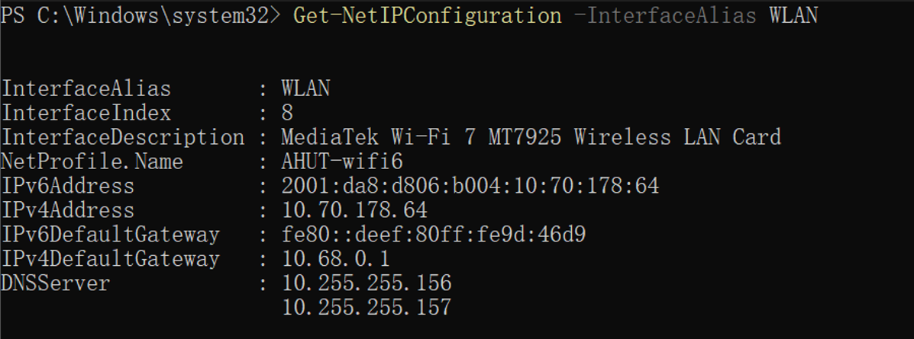
结合命令运行的结果我们不难发现，当前网卡的`IPv4`地址为`10.70.178.64`，然后我们就可以执行下面的命令来查询到当前网卡的`ARP`缓存信息
```powershell
arp -a -N 10.70.178.64
```
命令的运行结果如下：
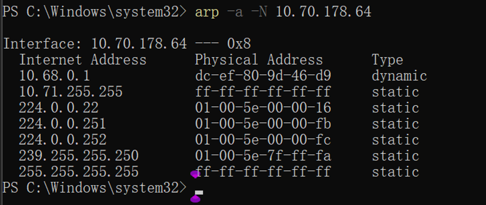
输出了一条动态的ARP记录之后我们就可以进行抓包操作了

### 软件抓包
接下来我们打开`WireShark`软件，在界面中点击捕获，然后再点击选项
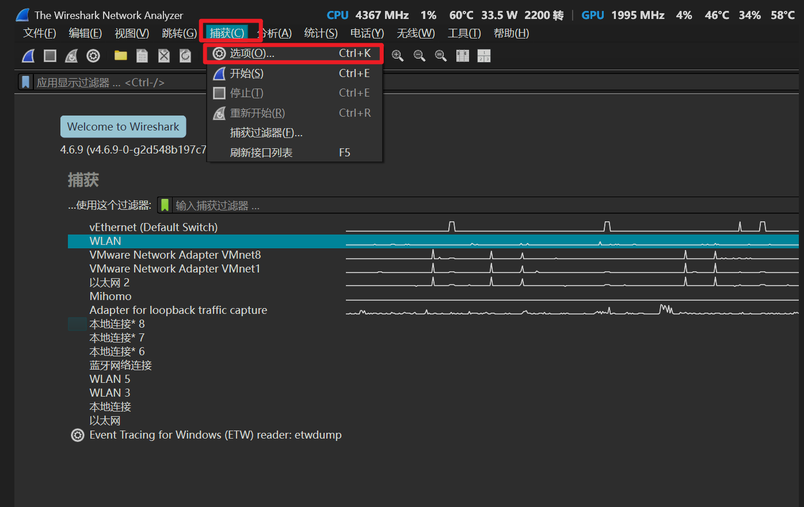
在接下来弹出的内容我我们选择`WLAN`，核对地址和我们刚才通过命令查看的地址一致之后我们就可以点击开始选项进行抓包
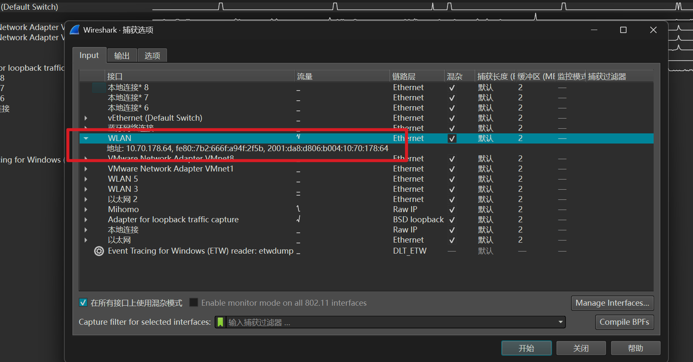
接下来我们需要在软件的顶部过滤栏中输入过滤条件`arp or icmp`这条指令会过滤其它信息，只保留`ARP`指令和`ICMP`协议的数据协议内容
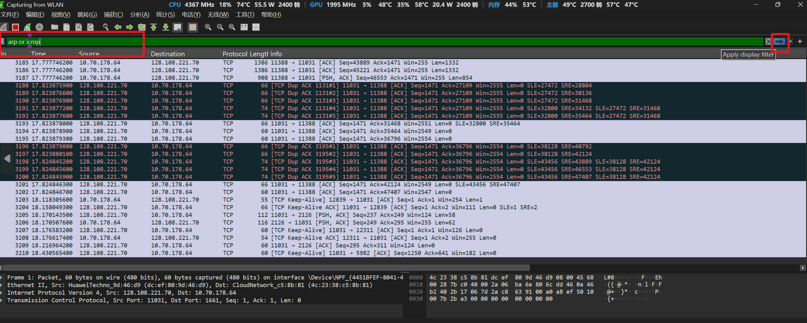
过滤生效之后软件内抓到的信息如下
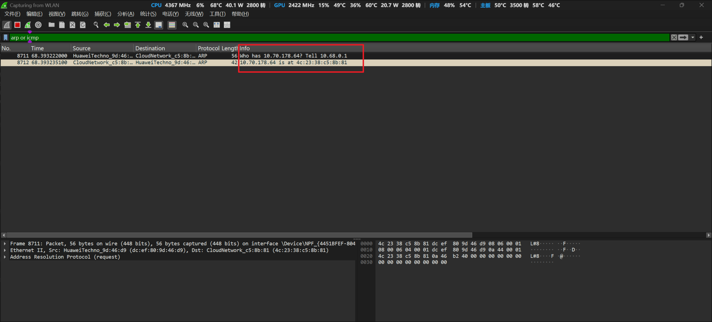
图中出现了两条`ARP`数据报，根据数据报发送的信息我们不看出默认网关在询问谁拥有 `10.70.178.64`？然后下一条数据报就将`10.70.178.64`对应的`MAC`地址回复给了网关
随后我们删除当前电脑中的`ARP`记录，让电脑本地的网卡重新建立`ARP`记录表
删除`WLAN`的`ARP`记录的命令是：
```powershell
arp -d 10.68.0.1 10.70.178.64
```
该命令会删除当前`WLAN`对应物理网卡上的网关缓存内容，删除之后我们再接着运行指令来重新建立`ARP`缓存
```powershell
ping -n 1 10.68.0.1
arp -a 10.68.0.1 -N 10.70.178.64
```
命令执行完成之后我们回到`wireshark`，然后我们点击红色方块停止抓包

### 抓包结果分析
当我们停止抓包之后接下来就要进行数据帧的分析了，我们在wires hark软件中就可以看到对应的抓包信息
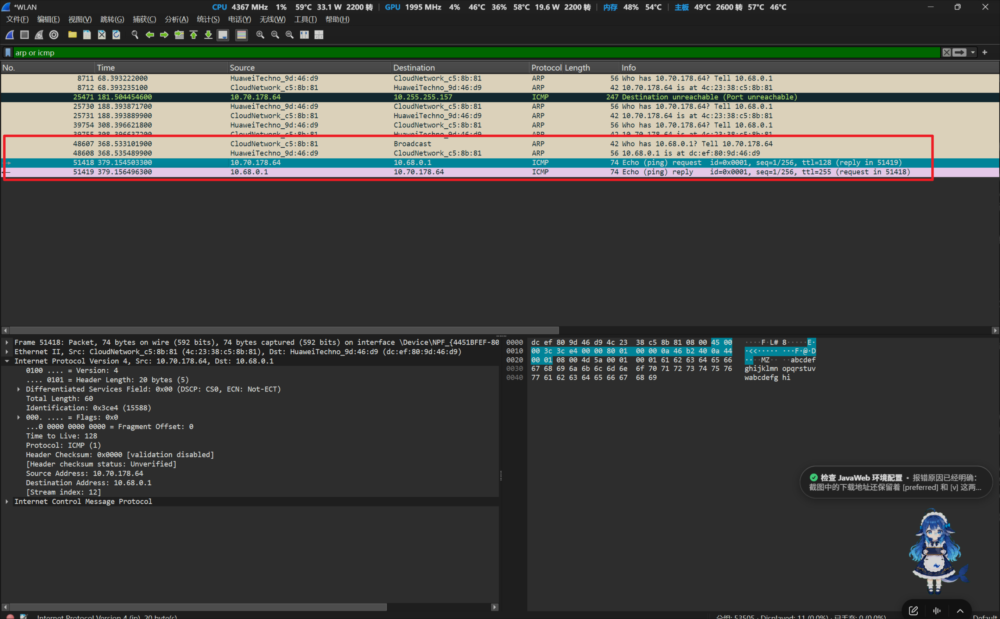
根据图中的信息我们不难发现，刚才执行的几条指令已经生效了，我们刚才删除了`WLAN`的`ARP`记录，因此在抓包中我们抓到了`48607`的`WLAN`在询问默认网关的`MAC`地址，随后`48608`数据报中网关将自己的`MAC`地址发送给了`WLAN`，接下来的`51418、51419`就是我们执行`ping`指令之后返回的结果
接下来我们将框内的过滤内容更换为
```txt
frame.number == 48607 || frame.number == 48608 || frame.number == 51418 || frame.number == 51419
```
执行之后就只剩下上面介绍过的这几个数据报了
接下来我们就展开分析一下这两个数据报的内容
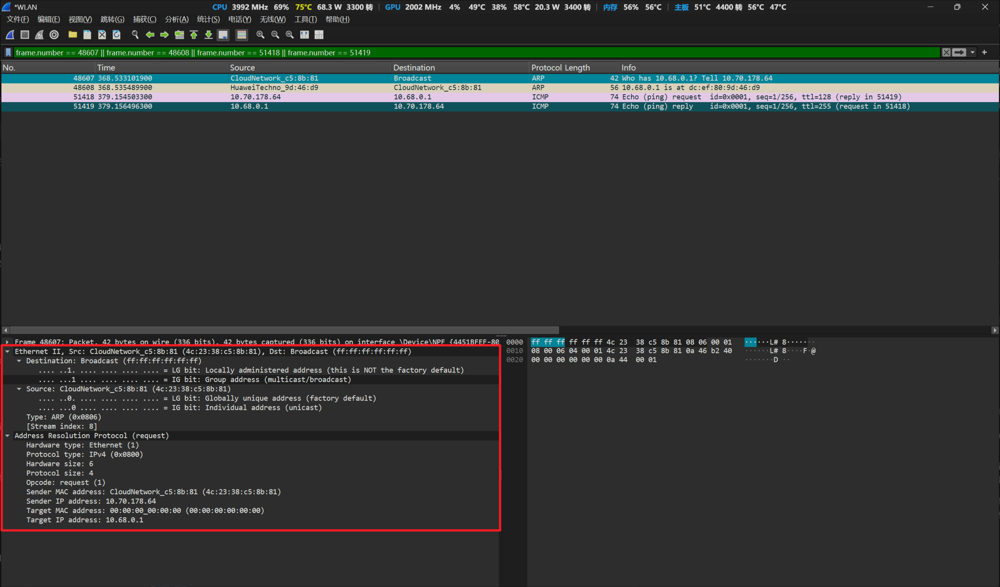
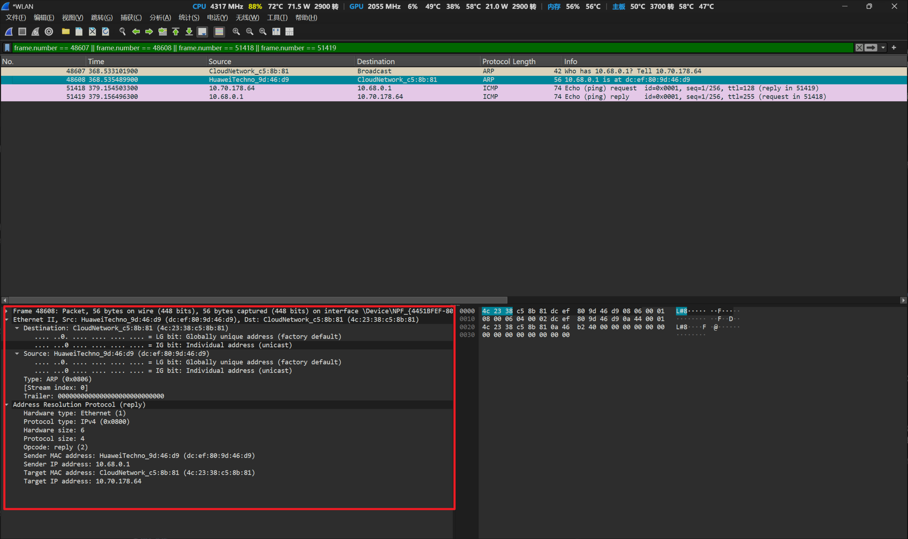
两张图中展示了关键字段，我们可以对比一下

| 字段                | ARP请求（48607）                          | ARP应答（48608）                          |
| ----------------- | ------------------------------------- | ------------------------------------- |
| `Ethernet`目的`MAC` | `ff:ff:ff:ff:ff:ff`，广播                | `4c:23:38:c5:8b:81`，发给本机              |
| Opcode            | `request (1)`                         | `reply (2)`                           |
| Sender IP / MAC   | 本机 `10.70.178.64 / 4c:23:38:c5:8b:81` | 网关 `10.68.0.1 / dc:ef:80:9d:46:d9`    |
| Target IP / MAC   | 网关 `10.68.0.1 / 00:00:00:00:00:00`    | 本机 `10.70.178.64 / 4c:23:38:c5:8b:81` |
请求中的 **Target MAC 全零**表示本机尚不知道要查询的 MAC；它与外层 Ethernet 的**广播目的 MAC**是两个不同字段。网关收到请求后，把自己的 IP 和 MAC 放在应答的 Sender 字段中，并将应答发回本机

接着我们需要验证缓存结果，在`power shell`中运行
```powershell
arp -a 10.68.0.1 -N 10.70.178.64
```
执行指令后的输出结果为
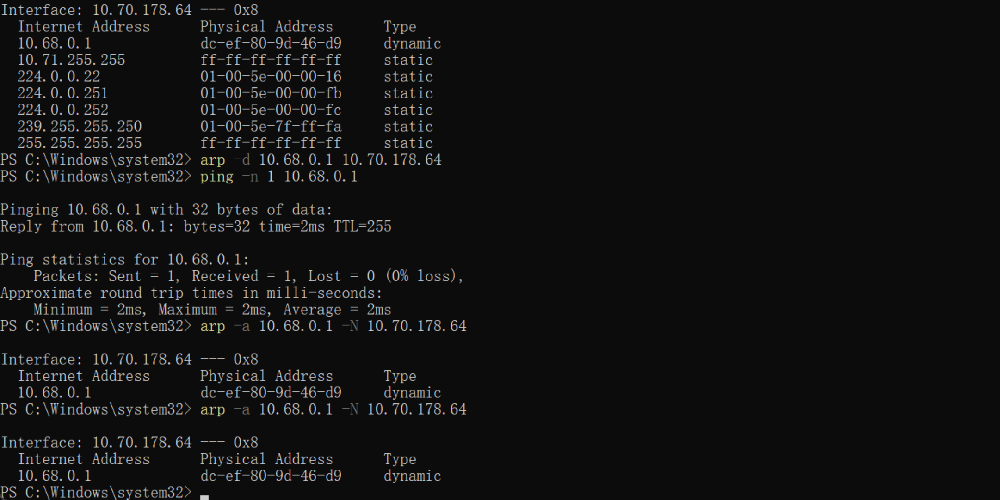
终端输出显示，删除网关缓存之后，ping一发一收、0%丢包；最终ARP表再次出现`10.68.0.1 → dc-ef-80-9d-46-d9` 的动态映射，当电脑想要把数据发给默认网关时，他就会把当前ARP映射中保存的`MAC`地址当成本地帧的目的地址

## 总结
我们在实验中的操作，映射到底层的内容如下图所示
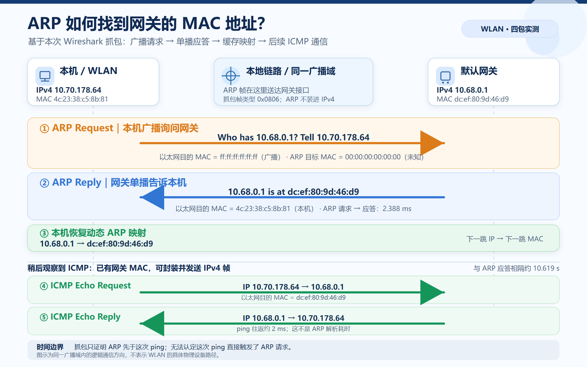
在本次实验中我们如果没有建立ARP缓存，那么ICMP的ping通信是无法到达目标目标网关的，但是实际使用过程中并不会出现`ping`失效的问题，因为系统会在底层为我们完成前置步骤，系统发现`ping`指令的`ICMP`请求失败之后就会发出`ARP`请求，记录`IP->MAC`映射，用网关MAC封装并发出`ICMP`请求，再等待`ping`回复